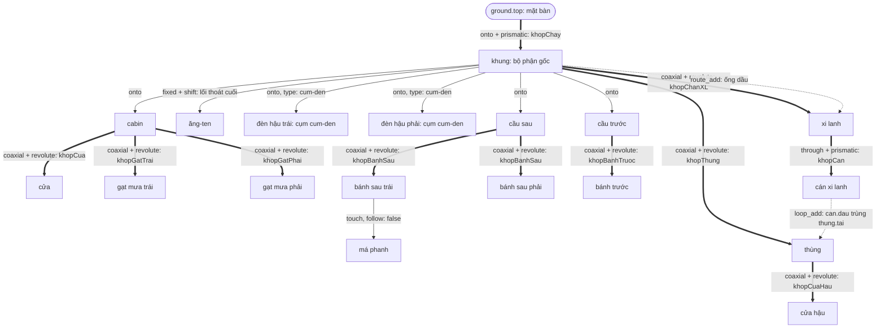
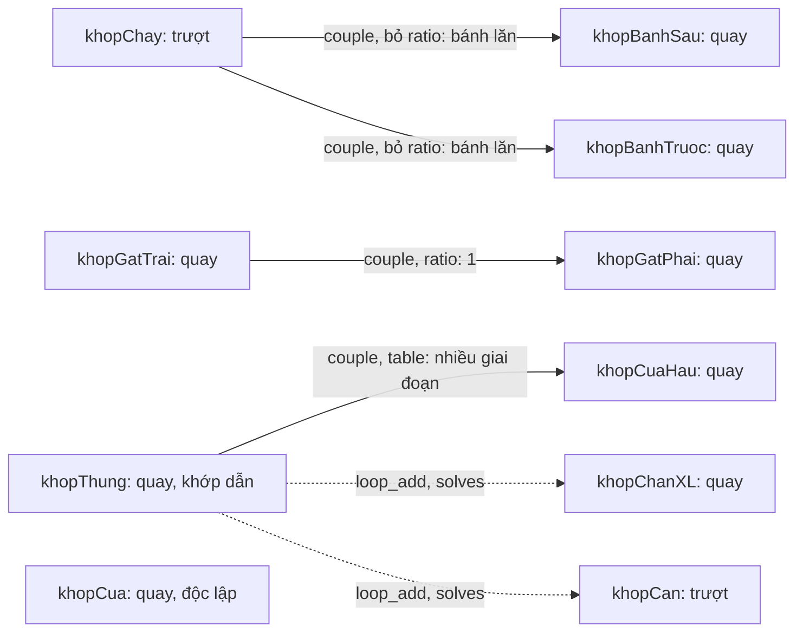
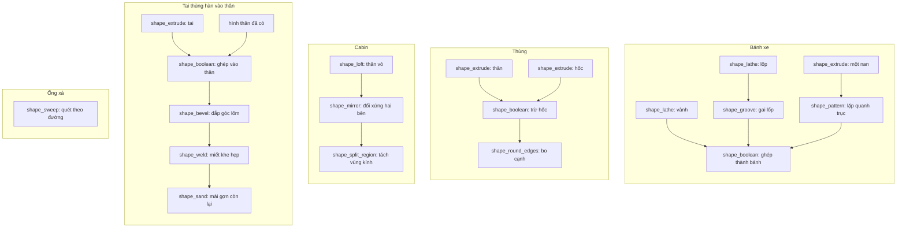

# Sơ đồ một bản lắp ráp: ví dụ xe ben

Xe ben này là **ví dụ minh hoạ**, gom đủ các trường hợp của `neviad-assembly` vào một vật. Nó chưa được dựng thật bằng công cụ; tên bộ phận, khớp và điểm neo đều do người viết đặt.

Mô hình cần nhớ:

| Khái niệm | Trong sơ đồ | Tool |
|---|---|---|
| Node | Bộ phận | `part_add` |
| Edge | Khớp: gắn chặt, quay hoặc trượt | `place` trong `part_add`, thêm `joint_add` nếu chuyển động |
| Cạnh phụ | Ràng buộc nằm ngoài cây | `loop_add`, `route_add` |
| Quan hệ giữa các khớp | Khớp này chạy theo khớp kia | `couple` trong `joint_add` |

## 1. Cây bộ phận

- **Mũi tên mảnh:** gắn chặt, 0 bậc tự do.
- **Mũi tên đậm:** có khớp, 1 bậc tự do.
- **Mũi tên nét đứt:** cạnh phụ, không thuộc cây.



`khopBanhSau` có `moves: ["banhSauTrai", "banhSauPhai"]`, nên một khớp điều khiển hai bộ phận và xuất hiện trên hai edge.

## 2. Quan hệ giữa các khớp

Sơ đồ này chỉ có khớp, không có bộ phận. Mỗi nhóm nối với nhau chuyển động cùng nhau, nên chỉ cần đặt `pose` cho một khớp bất kỳ trong nhóm là cả nhóm đi theo.



Lệnh khép vòng xi lanh:

```jsonc
loop_add {
  "assembly": "xe-ben",
  "id": "vongXiLanh",
  "a": "can.dau",
  "b": "thung.tai",
  "solves": ["khopChanXL", "khopCan"]
}
```

## 3. Cây dựng hình bên trong chi tiết

Mỗi bộ phận trong sơ đồ 1 là một `shape:<id>`. Bên trong, hình được dựng từ nhiều phép, và một hình có thể dùng nhiều đầu vào, nên phần này không phải lúc nào cũng là cây thuần tuý.



Sau khi khoét, điểm neo được kế thừa từ dao cắt, ví dụ `thung.hoc.axis`; với phần lặp là `nan[2].axis`.

## 4. Bảng đối chiếu các trường hợp

| Trường hợp | Ví dụ trong xe ben | Cách khai |
|---|---|---|
| Bộ phận gốc | `khung` | `part_add`, `place: onto` lên `ground.top` |
| Gốc chuyển động | `khung` chạy trên mặt bàn | `joint_add` kiểu `prismatic`, trục `ground.z` |
| Gắn chặt mặt vào mặt | `cabin` lên `khung` | `place: onto`, không có khớp |
| Tiếp xúc, không quay theo | `maPhanh` tì lên bánh | `place: touch`, `follow: false` |
| Lối thoát cuối cùng | `anten` | `place: fixed`, `shift` |
| Dùng lại cụm | `denTrai`, `denPhai` | `part_save_as_type`, rồi `part_add` với `type: "cum-den"` |
| Khớp quay độc lập | `khopCua` | `coaxial`, `revolute`, `limits` |
| Trục lọt lỗ và trượt | `can` trong `xiLanh` | `through`, `prismatic` |
| Một khớp, nhiều bộ phận | `khopBanhSau` | `moves` có hai bộ phận |
| Chạy theo tỉ số | `khopGatPhai` | `couple: {joint, ratio}` |
| Bánh lăn theo khớp trượt | `khopBanhSau`, `khopBanhTruoc` | `couple: {joint}`, bỏ `ratio` |
| Phi tuyến, nhiều giai đoạn | `khopCuaHau` | `couple: {joint, table}` |
| Khâu nối hai nhánh | `xiLanh` và `can` với `thung` | `loop_add`, `solves` |
| Dây nối | ống dầu | `route_add` |
